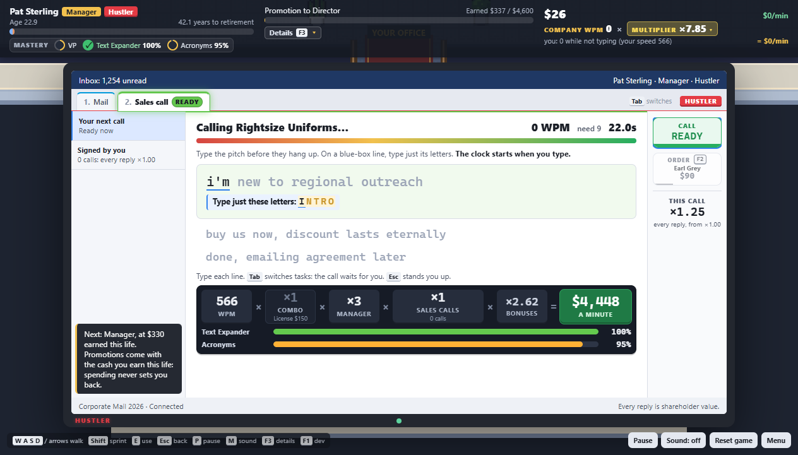

## Hi, I'm Jensen

I lead B2B sales for a UC Davis professional-education division. Before that I spent nearly four years in field and territory sales at TTI and Milwaukee Tool.

My role in leading B2B sales for my UC Davis division with limited resources led me to use and build sales resources with AI agents.

I'm the division's only B2B seller. There's no SDR team doing research for me and no sales-engagement platform like Outreach or Apollo, and every hour spent building lists is an hour not spent talking to buyers. So I built the research and drafting work myself with AI agents, and kept the judgment calls (who's a fit, what gets sent) with me.

The code stays private, so this page covers what each project does and the part I played.

---

### AI-agent sales workflow (UC Davis B2B sales)

This is the workflow my B2B outreach runs on, built with OpenAI Codex. For each batch of target organizations it:

- scores the account for fit against our training programs, giving a go/no-go with reasons
- researches the HR and L&D decision-makers
- drafts a tailored email and a call script for each contact
- tracks follow-ups

I review every batch by hand before anything goes out.

**My part:** I wrote the scoring rules and the program "expert" instructions the agents use, and I review the agents' output. I decide what gets sent.

*It runs on my employer's prospect data, so there's no public code or sample output.*

---

## Personal projects, built the same way

### RaffleReady: a personal sweepstakes catalog

A nightly pipeline built with Claude Code and OpenRouter. It finds US sweepstakes, pulls the rules and deadlines out of each listing with an AI model, checks that every link still works, and builds one catalog I can work through each day.

- Runs each night: discover → extract → enrich → merge → prune
- Has a daily budget of model calls, logged per run, so it can't run up a bill
- Keeps personal details on my machine and out of the catalog
- Leaves CAPTCHAs to a person; the software never solves them

**My part:** product rules, architecture decisions (for example, keeping personal data separate from the shared catalog), the budget guardrails, and the QA checks.

---

### Corporate Climb: a PC typing game

A typing incremental game about climbing the corporate ladder. Yes, there's a sales-call minigame. It's unreleased and aimed at Steam.

**My part:** I write the game design and the specs, playtest it, and decide what changes. Claude Code agents write and test all the code, including a balance simulator that checks the game's pacing math.

---

**Contact:** [LinkedIn](https://www.linkedin.com/in/jensen-ready-24b323195)
